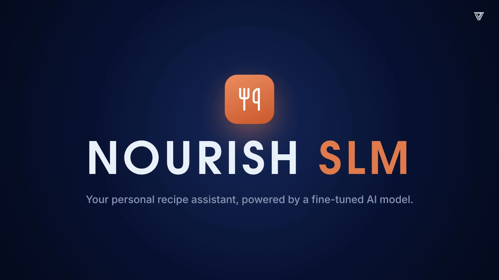
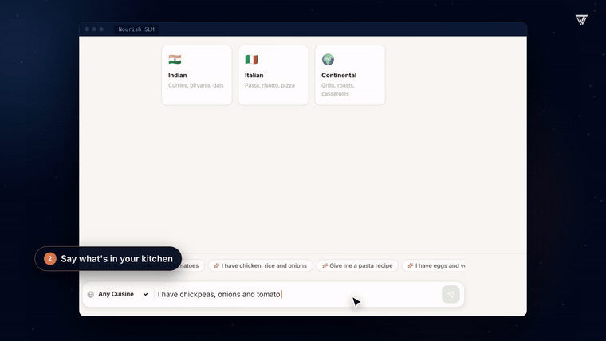
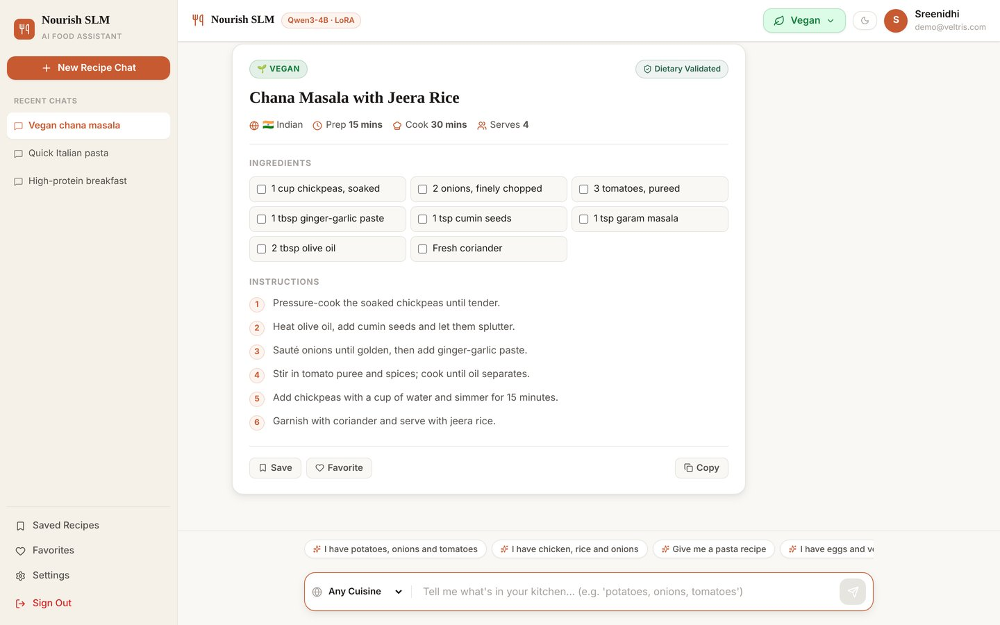

# Nourish SLM

**A personalized recipe assistant powered by a fine-tuned small language model.** Tell it what is in your kitchen and how you eat; Nourish writes a complete recipe and checks every ingredient against your diet before you see it. Built for Veltris by KM Sreenidhi, Woxsen University.

[](docs/media/nourish-slm-demo.mp4)

▶ **[Watch the 2-minute demo video](docs/media/nourish-slm-demo.mp4)** · 📄 **[Technical report (PDF)](docs/Nourish_SLM_Technical_Report.pdf)**



## Highlights

- **Fine-tuned open model:** Qwen3-4B with a LoRA adapter, trained on Food.com recipes. Runs on your own hardware, with no external LLM API.
- **Diet-safe by design:** a deterministic validator checks every ingredient for Vegan, Vegetarian, Eggitarian and Non-vegetarian diets and swaps anything that breaks the rules (for example ghee to olive oil in a vegan dish).
- **Never an empty answer:** if the model's output is unusable, the backend falls back to a retrieved dataset recipe, then to a template.
- **Full product:** React chat UI with recipe cards, saved recipes, favorites, instant diet switching, and light and dark themes.

| Metric (held-out test set) | Base Qwen3-4B | Fine-tuned |
| --- | --- | --- |
| Test loss | 2.895 | **1.106** (62% lower) |
| Perplexity | 18.1 | **3.0** |
| Complete, well-formed recipes | 66.7% | **97.0%** |
| Dietary compliance | 100% | **100%** |

The validator also passes 50 of 50 hand-written test cases at about 0.1 ms per check.



## How it works

```
React UI ─▶ FastAPI (JWT auth) ─▶ diet + cuisine ─▶ recipe retrieval (229k recipes)
                                                          │
Recipe card ◀─ JSON recipe ◀─ dietary validator ◀─ Qwen3-4B + LoRA
     │                                                    │ output unusable?
 SQLite / PostgreSQL                         retrieved recipe ─▶ template
```

| Layer | Stack |
| --- | --- |
| Frontend | React 18, TypeScript, Vite |
| Backend | FastAPI, SQLAlchemy, JWT (python-jose), bcrypt |
| Model | Qwen/Qwen3-4B + LoRA (r 16, α 32) via PyTorch, Transformers, PEFT |
| Data | Food.com `RAW_recipes.csv`: 231,637 recipes cleaned to 229,168, each labeled by diet |
| Training | QLoRA (4-bit base), 6,000 examples, 375 steps, 55 min on one RTX 4070 |

## Quick start (macOS, Apple Silicon)

**Requirements:** an M-series Mac with 16 GB RAM, about 10 GB free disk, Python 3.10+ and Node.js 18+ (`brew install python@3.12 node`).

```bash
git clone https://github.com/sreenidhi-km/nourish-slm.git
cd nourish-slm
./run_on_mac.command
```

The script creates a virtual environment, installs dependencies, downloads the model and data (about 8 GB the first time), creates `.env` with a fresh secret key, builds the frontend, starts both servers and opens http://localhost:5173. You can also double-click `run_on_mac.command` in Finder.

Then:

1. Create an account and pick your diet.
2. Type what you have, for example *"I have chickpeas, onions and tomatoes. Make me something Indian."*
3. Get a validated recipe in a few seconds. Save it, favorite it, or switch diets from the header at any time.

Press **Ctrl+C** in the terminal to stop.

## Manual setup

```bash
python3.12 -m venv .venv && source .venv/bin/activate
pip install -r requirements.txt
bash scripts/download_assets.sh            # adapter weights, recipe data, base model
cp .env.example .env                       # then set SECRET_KEY

# Terminal 1 - backend
PYTORCH_ENABLE_MPS_FALLBACK=1 python -m uvicorn backend.app.main:app --port 8000

# Terminal 2 - frontend
cd frontend && npm ci && npm run dev       # http://localhost:5173
```

Set `SLM_GENERATE=false` to skip the neural model and run in fast retrieval-only mode.

## Deploying

**Docker (backend + PostgreSQL):** run `bash scripts/download_assets.sh`, set `SECRET_KEY` and `POSTGRES_PASSWORD` in `.env`, then `docker-compose up --build -d`. Containers on a Mac can't use the Apple GPU, so use a Linux host with an NVIDIA GPU for real traffic.

**Linux GPU server:** install a CUDA build of PyTorch and `requirements.txt`, build the frontend with `VITE_API_URL=/api npm run build`, run `uvicorn backend.app.main:app --host 127.0.0.1 --port 8000 --workers 1`, and serve `frontend/dist` with Nginx, proxying `/api/` to port 8000. The [technical report](docs/Nourish_SLM_Technical_Report.pdf) has the full step-by-step guide.

Main settings in `.env`: `SECRET_KEY` (required), `DATABASE_URL` (defaults to SQLite), `CORS_ORIGINS`, `SLM_GENERATE`, `SLM_MAX_NEW_TOKENS`.

## Project structure

```
backend/app/          FastAPI app: api/ routes, services/ (validator, retrieval, model), models/, schemas/
model/                inference engine, config, evaluation
models/qwen3-4b-recipe-lora/   LoRA adapter (weights downloaded by scripts/download_assets.sh)
frontend/             React + TypeScript UI
notebooks/            qwen3_4b_finetuning.ipynb (training) and results/
scripts/              data preparation, evaluation, demo seeding, asset download
tests/                classifier, validator and API tests
docs/                 demo video, screenshots, technical report
run_on_mac.command    one-click setup and launch
```

## Reproducing the model

1. Download `RAW_recipes.csv` from the [Food.com Recipes and Interactions dataset](https://www.kaggle.com/datasets/shuyangli94/food-com-recipes-and-user-interactions) into `data/raw/`.
2. Run `python scripts/prepare_foodcom_data.py` to build `data/processed/foodcom_cleaned.csv`.
3. Open `notebooks/qwen3_4b_finetuning.ipynb` on a machine with an NVIDIA GPU (12 GB+ VRAM) and run all cells. The adapter is written to `models/qwen3-4b-recipe-lora/`.
4. Evaluate with `python scripts/run_full_evaluation_and_latency.py`.

## Tests

```bash
SLM_GENERATE=false python -m pytest tests/test_classifier.py tests/test_backend.py
```

## Limitations

- Diet checks are keyword-based and can miss hidden animal products (for example Worcestershire sauce). Not a substitute for allergen or medical advice.
- Trained for one epoch on 6,000 examples; more data should improve recipe quality further.
- The UI currently offers Indian, Italian and Continental cuisines.

---

Built by **KM Sreenidhi** (Woxsen University) for **Veltris** · Innovate | Accelerate | Transform
